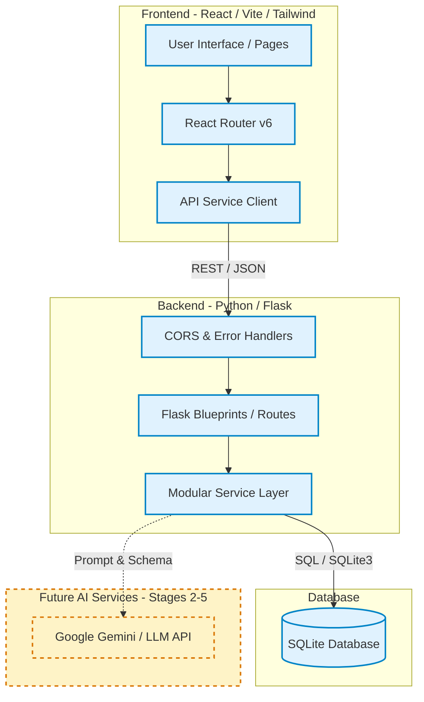
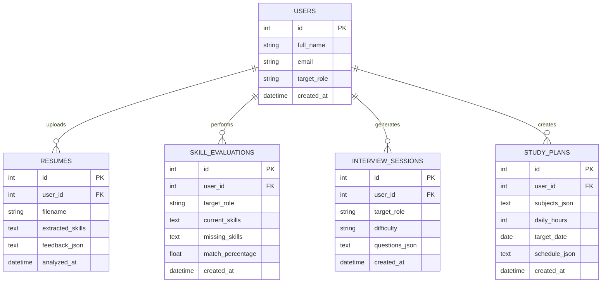
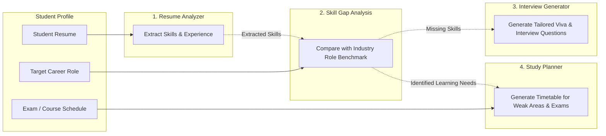

# SYSTEM ARCHITECTURE: AI Academic & Career Copilot

This document specifies the technical design, architectural patterns, component interactions, and data flows of the **AI Academic & Career Copilot**.

---

## 1. High-Level System Architecture

The application adopts a decoupled client-server architecture. The frontend is a Single Page Application (SPA) communicating over RESTful HTTP/JSON with a lightweight Python Flask backend, backed by an SQLite relational database.



> **Legend:**  
> - Solid Blue Box: **Implemented in Stage 1**  
> - Dashed Yellow Box: **Planned for Stages 2 to 5**

---

## 2. Frontend Architecture (React + Vite + TypeScript)

The frontend is structured into discrete layers according to single-responsibility principles:

```text
frontend/src/
├── components/       # Presentational & interactive UI building blocks (Buttons, Cards, Badges)
├── layouts/          # Application shell (DashboardLayout: Sidebar, Header, Breadcrumbs)
├── pages/            # View controllers bound to application routes
├── services/         # HTTP abstraction communicating with backend endpoints
├── hooks/            # Custom reusable React hooks (e.g., useBackendStatus)
├── types/            # TypeScript interfaces, DTOs, and route definitions
├── utils/            # Pure helper utilities
├── App.tsx           # Route provider and global layout wrapping
└── main.tsx          # React application root DOM mount
```

### Routing Structure
| Route | Page Component | Stage | Description |
| :--- | :--- | :---: | :--- |
| `/` | `Dashboard` | Stage 1 | Main overview, quick navigation cards, workflow guide |
| `/resume-analyzer` | `ResumeAnalyzer` | Stage 1 Shell (Active Stage 2) | Resume upload interface & analysis preview |
| `/skill-gap` | `SkillGap` | Stage 1 Shell (Active Stage 3) | Target role & current skill comparison preview |
| `/interview-generator` | `InterviewGenerator`| Stage 1 Shell (Active Stage 4) | Technical/behavioral question configuration preview |
| `/study-planner` | `StudyPlanner` | Stage 1 Shell (Active Stage 5) | Subject timetable parameters preview |
| `/history` | `History` | Stage 1 Shell (Active Stage 6) | Historical sessions view (empty state) |
| `/settings` | `Settings` | Stage 1 Shell | Profile, API ping, and theme preferences |
| `/*` | `NotFound` | Stage 1 Shell | 404 catch-all fallback with dashboard navigation |

---

## 3. Backend Architecture (Python + Flask)

The backend employs an Application Factory pattern with modular Blueprints to maintain clean boundary separation between HTTP routing and business logic.

```text
backend/
├── app/
│   ├── routes/           # Blueprints handling HTTP requests and response serialization
│   │   ├── __init__.py
│   │   ├── health.py     # [IMPLEMENTED] Health check endpoint
│   │   ├── resume.py     # [PLANNED Stage 2] Resume endpoints
│   │   ├── skills.py     # [PLANNED Stage 3] Skill gap endpoints
│   │   ├── interview.py  # [PLANNED Stage 4] Interview question endpoints
│   │   └── study.py      # [PLANNED Stage 5] Study planner endpoints
│   ├── services/         # Business logic layer (isolated from Flask request context)
│   │   ├── __init__.py
│   │   ├── ai_service.py # Future LLM connector
│   │   ├── resume_service.py
│   │   ├── skill_service.py
│   │   ├── interview_service.py
│   │   └── study_service.py
│   ├── models/           # Data access objects and database interaction
│   ├── utils/            # Error handling, standard JSON responses
│   ├── config.py         # Config classes (DevelopmentConfig, ProductionConfig)
│   └── __init__.py       # create_app() factory
├── app.py                # Server entrypoint
└── requirements.txt      # Python dependencies
```

---

## 4. Database Architecture (SQLite)

SQLite is utilized as the database engine for academic reliability and zero-configuration demonstration portability.

### Entity Relationship Diagram


> **Stage 1 Note:** The schema definitions and table creation script (`database/init_db.py`, `database/schema.sql`) are established now so that future stages can query and persist data seamlessly.

---

## 5. API & Service Layer Concept

To make the codebase maintainable and readily explainable during an academic viva:
1. **Controllers (Routes)**: Solely responsible for validating incoming request JSON, calling the appropriate Service method, and formatting the JSON HTTP response.
2. **Services**: Contain pure business logic and external integrations (e.g., prompt crafting, database transactions). They do not know about HTTP headers or status codes.
3. **Standard Response Contract**:
   ```json
   {
     "success": true,
     "data": { ... },
     "message": "Optional status description",
     "error": null
   }
   ```

---

## 6. Future AI Integration Architecture (Stages 2 to 5)

When integrating Generative AI in subsequent stages:
- **No Hardcoded Keys:** AI credentials will be loaded strictly from system environment variables (`GEMINI_API_KEY`).
- **Standardized Prompts:** Prompts will be stored in template files or dedicated prompt builders under `backend/app/services/prompts/`.
- **Structured Outputs:** Requests will utilize strict JSON schema formatting so that outputs from the LLM can be parsed reliably into typed backend DTOs.
- **Graceful Fallbacks:** If an LLM call fails or times out, the service layer will return structured, informative errors rather than crashing the Flask application.

---

## 7. Relationship Between the Four Core Modules



This pipeline creates a closed-loop student preparation system:
1. **Resume Analyzer** reveals what skills the student currently showcases.
2. **Skill Gap Analysis** compares those skills with what their target role requires.
3. **Interview Generator** focuses questions specifically on the student's target role and identified weak points.
4. **Study Planner** factors identified skill gaps and course deadlines into an actionable daily study schedule.
