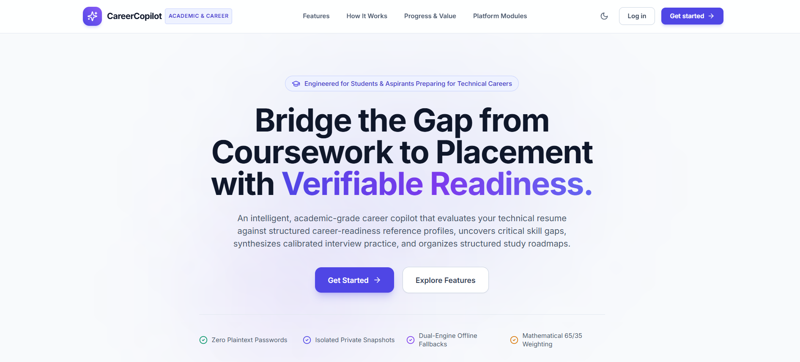
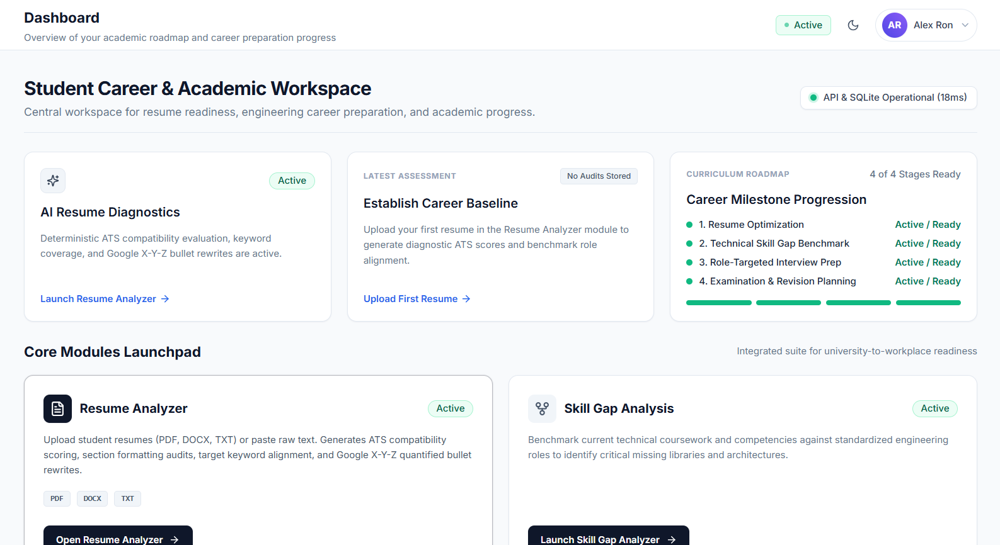
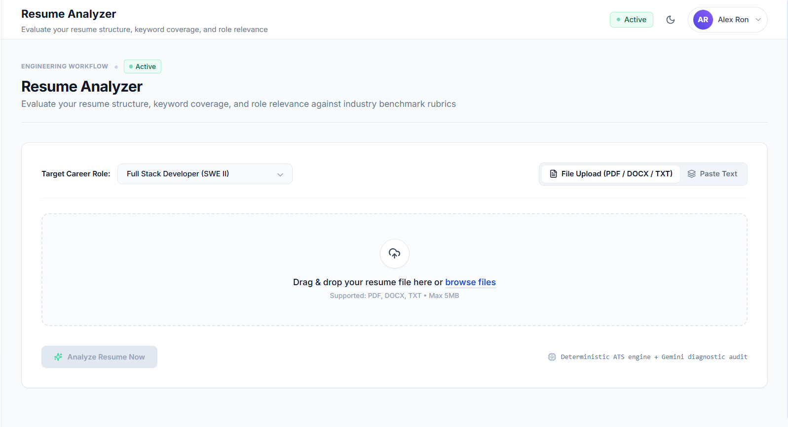
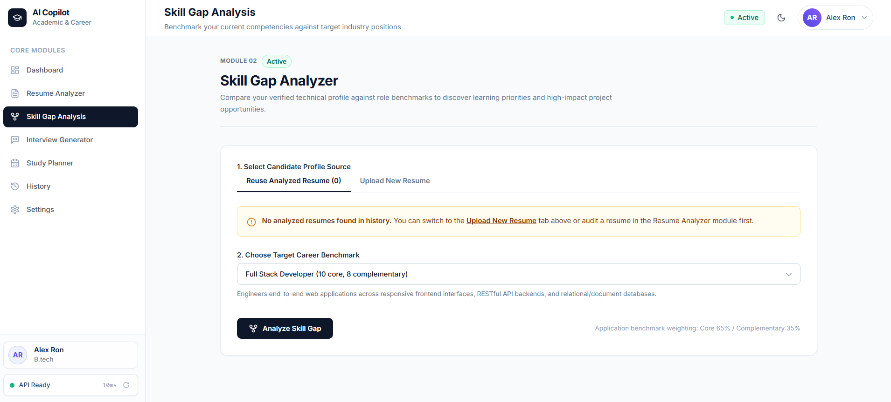

# AI Academic & Career Copilot
> **An Intelligent Student Career & Academic Preparation Platform**

[](LICENSE)
[](https://www.python.org/)
[](https://react.dev/)
[](https://www.typescriptlang.org/)
[](https://vitejs.dev/)
[](https://tailwindcss.com/)

🚀 **Live Demo:** [https://ai-academic-career-copilot.vercel.app/](https://ai-academic-career-copilot.vercel.app/)<br>
📡 **Live Backend Health:** [https://ai-academic-career-copilot.onrender.com/api/health](https://ai-academic-career-copilot.onrender.com/api/health)

A full-stack, AI-powered web platform designed to support college students and early-career software developers in academic planning and technical career readiness. AI Academic & Career Copilot consolidates multi-format resume parsing and ATS auditing, target role skill gap analysis, AI mock interview generation, personalized study schedule generation, and historical snapshot tracking into a unified, distraction-free interface.

---

## Live Demo & Deployment Status

- **Live Application:** [https://ai-academic-career-copilot.vercel.app/](https://ai-academic-career-copilot.vercel.app/)
- **Backend API Health Check:** [https://ai-academic-career-copilot.onrender.com/api/health](https://ai-academic-career-copilot.onrender.com/api/health)
- **Deployment Status:**
  - **Frontend:** Deployed and actively accessible on Vercel.
  - **Backend:** Deployed and healthy on Render, responding to health probes and API requests.
  - **Live Verification:** Core application workflows (user authentication, resume parsing, ATS auditing, skill gap evaluation, interview question generation, and study plan creation) have been manually tested on the live deployment.

> [!WARNING]
> **Demo Data Persistence & Ephemeral Storage Notice:**
> - **Render Free Cold Starts:** Render spins down free web service instances after 15 minutes of inactivity. When visiting the demo after an idle period, the initial request may take ~45–60 seconds while the container spins up.
> - **Ephemeral Storage:** The deployed backend runs on Render's Free tier using a container-local SQLite database. Container storage on this tier is **ephemeral**. Accounts created, resumes uploaded, and saved history records will reset whenever the Render container is restarted or redeployed. This demo is intended for academic, recruiter, and portfolio demonstration and does not provide durable or production-grade persistence.

---

## Deployment Architecture

The live application is hosted using a decoupled full-stack architecture:

- **Frontend (Vercel):** The React 18 + TypeScript single-page application (SPA) is built with Vite and hosted on Vercel's edge network.
- **Backend (Render):** The Python 3.11 + Flask API is hosted as a web service on Render, served via Gunicorn WSGI using an application factory pattern (`gunicorn --chdir backend "app:create_app()"`).
- **API Proxy Routing:** Vercel routes all `/api/*` traffic directly to the live Render backend via an edge rewrite rule (`frontend/vercel.json`), enabling same-origin session cookie authentication (`SameSite=Lax`) without cross-domain browser restrictions.
- **Database Initialization:** The SQLite database is automatically created and idempotently migrated on backend container startup (`python database/init_db.py`).

---

## Table of Contents

- [Live Demo & Deployment Status](#live-demo--deployment-status)
- [Deployment Architecture](#deployment-architecture)
- [Screenshots](#screenshots)
- [Core Modules](#core-modules)
- [Technology Stack](#technology-stack)
- [Project Architecture](#project-architecture)
- [Prerequisites](#prerequisites)
- [Local Installation & Setup](#local-installation--setup)
  - [1. Clone Repository](#1-clone-repository)
  - [2. Backend Setup](#2-backend-setup)
  - [3. Frontend Setup](#3-frontend-setup)
- [Environment Configuration](#environment-configuration)
  - [AI Engine & Offline Heuristic Fallback Note](#ai-engine--offline-heuristic-fallback-note)
- [Database Initialization](#database-initialization)
- [Running the Application](#running-the-application)
- [Automated Testing & Verification](#automated-testing--verification)
- [Deployment Guide (Vercel & Render)](#deployment-guide-vercel--render)
- [Limitations & Project Status](#limitations--project-status)
- [License](#license)

---

## Screenshots

### Public Landing Page

*Public landing page presenting core platform capabilities, architectural highlights, and student preparation workflows.*

### Student Career & Academic Workspace (Dashboard)

*Central dashboard displaying active readiness milestones, diagnostic health checks, and module launchpads.*

### AI Resume Diagnostics & Analyzer

*Multi-format resume analysis interface supporting PDF, DOCX, and TXT parsing with role benchmark targets.*

### Technical Skill Gap Evaluation

*Skill gap analysis comparing student competencies against standardized engineering profiles to isolate high-priority learning paths.*

---

## Core Modules

| Module | Route | Description |
| :--- | :--- | :--- |
| **Public Landing Page** | `/` | Responsive landing page introducing platform capabilities, core workflows, and architectural transparency for prospective students. |
| **Dashboard** | `/` *(authenticated)* | Central launchpad featuring quick-action shortcuts, workflow status indicators, and live backend connectivity status. |
| **AI Resume Analyzer** | `/resume-analyzer` | Multi-format resume parser (PDF, DOCX, TXT) with ATS scoring (0–100), subscore breakdowns, formatting audits, and Google X-Y-Z formula bullet rewrite suggestions with 1-click clipboard copy. |
| **Skill Gap Analyzer** | `/skill-gap` | Evaluates student competencies against 6 industry role benchmarks or custom job descriptions. Identifies verified strengths, missing critical skills, and prioritized learning paths. |
| **AI Interview Generator** | `/interview-generator` | Produces role-tailored technical, behavioral, and system design interview questions with difficulty levels, evaluation rubrics, and model answers. |
| **AI Study Planner** | `/study-planner` | Builds day-by-day, structured study schedules based on subject priority, exam/interview deadlines, and available daily study hours, with session completion tracking. |
| **History & Snapshot Archive** | `/history` | Per-user archive of saved resume evaluations, skill gap reports, and study timetables, supporting longitudinal progress review. |
| **Account & Settings** | `/settings`, `/login`, `/signup` | Session-based authentication with bcrypt password hashing, per-user data isolation, profile preference controls, and light/dark theme toggle. |

---

## Technology Stack

### Frontend
- **Framework & Tooling:** [React 18](https://react.dev/) + [Vite 6](https://vitejs.dev/)
- **Language:** [TypeScript 5](https://www.typescriptlang.org/)
- **Styling:** [Tailwind CSS 3.4](https://tailwindcss.com/) with PostCSS & Autoprefixer
- **Routing:** [React Router v6](https://reactrouter.com/) (declarative routing with protected route guards)
- **Icons:** [Lucide React](https://lucide.dev/)
- **State Management:** React Context (`AuthContext`, `ResumeContext`, `ThemeContext`) with local storage synchronizers

### Backend
- **Language & Runtime:** Python 3.11+
- **Web Framework:** [Flask 3.0](https://flask.palletsprojects.com/) (RESTful application factory & Blueprints)
- **CORS Handling:** Flask-CORS
- **Configuration Management:** python-dotenv
- **Document Processing:** [pypdf](https://pypdf.readthedocs.io/) (PDF text extraction), [python-docx](https://python-docx.readthedocs.io/) (Word document parsing)
- **AI Integration:** [google-genai](https://pypi.org/project/google-genai/) SDK (Gemini API)

### Database
- **Engine:** [SQLite 3](https://www.sqlite.org/) (embedded, zero-configuration, relational database with foreign key enforcement and write-ahead logging support)

---

## Project Architecture

```text
AI Academic Career Copilot/
├── frontend/                     # React + Vite + TypeScript frontend
│   ├── src/
│   │   ├── components/           # Reusable UI components (Navbar, Header, Sidebar, Cards, Badges)
│   │   ├── context/              # Global state contexts (AuthContext, ResumeContext, ThemeContext)
│   │   ├── layouts/              # DashboardLayout & AppLayout shells
│   │   ├── pages/                # LandingPage, Dashboard, ResumeAnalyzer, SkillGap,
│   │   │                         # InterviewGenerator, StudyPlanner, History, Settings, Login, Signup
│   │   ├── services/             # Axios/fetch API wrappers (api.ts, auth.ts, etc.)
│   │   ├── types/                # Shared TypeScript definitions
│   │   ├── App.tsx               # Client router & route protection
│   │   └── main.tsx              # Application entrypoint
│   ├── package.json              # Frontend dependencies & build scripts
│   ├── tsconfig.json             # TypeScript compiler configuration
│   └── vite.config.ts            # Vite bundler & backend reverse-proxy settings
│
├── backend/                      # Python Flask backend
│   ├── app/
│   │   ├── routes/               # Blueprint endpoints (auth, resume, skill_gap, interview, study, health)
│   │   ├── services/             # Business logic layer (gemini_service, parsers, heuristic fallbacks)
│   │   ├── models/               # SQLite query helpers & data mapping
│   │   ├── utils/                # Response formatters, error handlers & decorators
│   │   ├── config.py             # Environment configuration classes
│   │   └── __init__.py           # Flask application factory
│   ├── app.py                    # Server startup script
│   ├── requirements.txt          # Python package dependencies
│   ├── verify_all_final.py       # Master backend test runner (10 suites, 97 checks)
│   └── test_*.py                 # Unit and integration test suites
│
├── database/                     # Database assets
│   ├── schema.sql                # SQLite relational schema definitions
│   └── init_db.py                # Schema initialization & table creation script
│
├── .env.example                  # Environment variable configuration template
├── .gitignore                    # Hardened Git exclusions
├── LICENSE                       # MIT License
├── LOCAL_RUN_GUIDE.md            # Detailed local startup instructions
└── README.md                     # Project documentation
```

---

## Prerequisites

Before running the application locally, ensure you have installed:

- **Python:** Version 3.11 or newer ([python.org](https://www.python.org/downloads/))
- **Node.js:** Version 18.x or newer ([nodejs.org](https://nodejs.org/))
- **npm:** Version 9.x or newer (bundled with Node.js)
- **Git:** (optional, for cloning)

---

## Local Installation & Setup

### 1. Clone Repository

```bash
git clone https://github.com/wallahcoding28/ai-academic-career-copilot.git
cd ai-academic-career-copilot
```

### 2. Backend Setup

Create and activate a Python virtual environment, then install the backend dependencies:

#### Windows (PowerShell):
```powershell
# Navigate to backend directory
cd backend

# Create virtual environment
python -m venv .venv

# Activate virtual environment
.\.venv\Scripts\Activate.ps1

# Install required packages
pip install -r requirements.txt

# Return to project root
cd ..
```

#### macOS / Linux:
```bash
# Navigate to backend directory
cd backend

# Create virtual environment
python3 -m venv .venv

# Activate virtual environment
source .venv/bin/activate

# Install required packages
pip install -r requirements.txt

# Return to project root
cd ..
```

### 3. Frontend Setup

From the project root, open a separate terminal and install the frontend dependencies:

```bash
cd frontend
npm install
```

---

## Environment Configuration

Configure your environment by copying `.env.example` to `.env` in the project root:

```bash
cp .env.example .env
```

### Key Configuration Variables

| Variable | Description | Default |
| :--- | :--- | :--- |
| `FLASK_ENV` | Application environment (`development` or `production`) | `development` |
| `PORT` | Flask backend port | `5000` |
| `HOST` | Flask host binding | `127.0.0.1` |
| `SECRET_KEY` | Flask session encryption key. Set to a strong random string. | `dev-fallback-secret-key-32bytes` |
| `DATABASE_PATH` | Relative or absolute path to SQLite database file | `database/copilot.db` |
| `CORS_ORIGIN` | Allowed client origin for CORS requests | `http://localhost:5173` |
| `GEMINI_API_KEY` | *(Optional)* Google Gemini API key for live LLM evaluations | *(Empty / Not set)* |

### AI Engine & Offline Heuristic Fallback Note

- **Supplying Your Own Key:** To enable live, dynamic AI evaluations powered by Google Gemini, obtain an API key from [Google AI Studio](https://aistudio.google.com/) and assign it to `GEMINI_API_KEY` in your `.env` file.
- **Deterministic Offline Fallbacks:** If `GEMINI_API_KEY` is not provided, the application activates built-in deterministic heuristic engines across all modules. This ensures the application remains fully testable, operable, and reviewable offline without external API dependencies.
- **Important Distinction:** Offline fallback engines use rule-based keyword matching, heuristic scoring rubrics, and pre-compiled academic datasets. **Their outputs are deterministic approximations and are not identical to dynamic Google Gemini LLM evaluations.**

---

## Database Initialization

Initialize the SQLite database schema before starting the server for the first time:

```bash
# From the project root, with your virtual environment activated:
python database/init_db.py
```

This creates `database/copilot.db` containing the necessary tables:
- `users` — Registered accounts and hashed credentials
- `resumes` — Parsed resumes, text snapshots, ATS scores, and audit findings
- `skill_evaluations` — Role benchmark evaluations, match percentages, and gaps
- `interview_sessions` — Generated technical/behavioral question sets
- `study_plans` — Structured study schedules and timetable metadata
- `study_sessions` — Daily study tasks and completion timestamps

---

## Running the Application

Running the application requires two active terminal sessions, both operated from the **project root directory**.

### Terminal 1: Backend Server

From the project root:

```powershell
# Windows PowerShell (from project root)
.\backend\.venv\Scripts\Activate.ps1
python backend/app.py
```

```bash
# macOS / Linux (from project root)
source backend/.venv/bin/activate
python backend/app.py
```

> **Working Directory Note:** Always run the backend server command from the project root. This ensures that relative path configuration (such as `DATABASE_PATH=database/copilot.db` in `.env`) resolves accurately to the root `database/` directory.

The Flask API server will start at:
- **API Server:** `http://127.0.0.1:5000`
- **Health Check Endpoint:** `http://127.0.0.1:5000/api/health`

### Terminal 2: Frontend Development Server

From the project root:

```bash
cd frontend
npm run dev
```

The Vite development server will start at:
- **Web Application:** `http://localhost:5173`

Open `http://localhost:5173` in your browser. When logged out, you will see the public landing page. Use **Sign Up** to create a local account or **Log In** to access the authenticated dashboard.

---

## Automated Testing & Verification

The project includes automated test suites covering backend API routes, SQLite constraints, user isolation, resume persistence, and frontend production compilation.

### Run Backend Verification (97 Checks Across 10 Suites)

The master backend verification script executes all test suites against an isolated test database and confirms that the development database undergoes zero modifications:

```powershell
# Windows PowerShell
& ".\backend\.venv\Scripts\python.exe" backend/verify_all_final.py
```

```bash
# macOS / Linux
python backend/verify_all_final.py
```

**Test suites executed:**
1. `test_database_hardening.py` — Database schema integrity and constraints
2. `test_e2e_user_workflow.py` — Full end-to-end user workflows
3. `test_audit.py` — Deep architectural and route audit assertions
4. `test_interview.py` — Interview question generation and fallback behavior
5. `test_qc_stage4.py` — Quality control assertions for Stage 4
6. `test_study.py` — Study planner algorithms and session toggles
7. `test_qc_stage5.py` — Quality control assertions for Stage 5
8. `test_qc_final_stage5.py` — Comprehensive Stage 5 quality gates
9. `test_resume_persistence.py` — Resume upload, retrieval, and persistence
10. `test_auth_and_isolation.py` — Session security, password hashing, and user data isolation

### Run Frontend Production Build & Type Checking

To verify that all TypeScript types, React components, and asset bundles compile without errors:

```bash
cd frontend
npm run build
```

This runs `tsc` (TypeScript compiler) followed by `vite build`.

---

## Deployment Guide (Vercel & Render)

The application is structured for cloud hosting using a decoupled architecture:
- **Frontend:** [Vercel](https://vercel.com/) (React + Vite static SPA edge hosting)
- **Backend:** [Render](https://render.com/) (Python 3.11 web service with Gunicorn WSGI)
- **API Routing:** Vercel reverse proxy rewrite (`/api/:path*` -> Render backend)

### 1. Backend Deployment (Render)

1. Connect the GitHub repository to Render as a **Web Service**.
2. Configure the build and start settings:
   - **Environment:** `Python 3`
   - **Build Command:** `pip install -r backend/requirements.txt`
   - **Start Command:** `python database/init_db.py && gunicorn --chdir backend "app:create_app()"`
3. Add environment variables in the Render dashboard:
   - `FLASK_ENV`: `production`
   - `SECRET_KEY`: *(Generate a secure 32-byte secret key, e.g. using `python -c "import secrets; print(secrets.token_hex(32))"`)*
   - `DATABASE_PATH`: `database/copilot.db`
   - `CORS_ORIGIN`: `https://<your-frontend>.vercel.app`
   - `SESSION_COOKIE_SECURE`: `true`
   - `GEMINI_API_KEY`: *(Optional — omit to run free offline deterministic engines)*
4. Once deployed, note your Render service URL (e.g., `https://ai-academic-career-copilot-api.onrender.com`).

Alternatively, Render can auto-configure these settings using the repository's root [`render.yaml`](render.yaml) blueprint.

### 2. Frontend Deployment (Vercel)

You can connect the Vercel frontend to the Render backend in one of two ways:

**Option A (Recommended — Same-Origin Reverse Proxy):**
1. [`frontend/vercel.json`](frontend/vercel.json) routes API requests to the live Render backend:
   ```json
   {
     "rewrites": [
       {
         "source": "/api/:path*",
         "destination": "https://ai-academic-career-copilot.onrender.com/api/:path*"
       },
       {
         "source": "/(.*)",
         "destination": "/index.html"
       }
     ]
   }
   ```
2. Import the repository into Vercel:
   - **Framework Preset:** `Vite`
   - **Root Directory:** `frontend`
   - **Build Command:** `npm run build`
   - **Output Directory:** `dist`
3. Deploy the project. Vercel automatically proxies `/api/*` requests to the Render backend, providing same-origin cookie authentication without cross-domain restrictions.

**Option B (Direct Cross-Origin API):**
- In the Vercel dashboard under **Settings > Environment Variables**, set:
  - `VITE_API_BASE_URL`: `https://<your-render-service>.onrender.com/api`
- Ensure `CORS_ORIGIN` on Render is set to your Vercel deployment URL (e.g. `https://<your-app>.vercel.app`).
- Set `SESSION_COOKIE_SAMESITE`: `None` and `SESSION_COOKIE_SECURE`: `true` on Render for cross-origin cookie authentication.

### Demo Data Persistence & Free-Tier Notice

> [!IMPORTANT]
> - **Free-Tier Spin Down:** Render's free tier spins down web services after 15 minutes of inactivity. The first request after a sleep cycle will experience a ~45–60 second cold start while the container spins up.
> - **Ephemeral Storage Limitation:** On Render's free plan, container filesystems are ephemeral. Any demo user accounts, uploaded resumes, or test evaluations created in the SQLite database will reset if the container is restarted or redeployed. For permanent demo data, attach a persistent disk volume on a paid plan or configure an external database.

---

## Limitations & Project Status

- **Academic Demonstration Scope:** AI Academic & Career Copilot was developed as an academic and educational capstone project demonstrating full-stack engineering, secure software architecture, and practical AI integration.
- **Not a Commercial SaaS:** This software is provided for personal, academic, and demonstration use. It is **not** currently packaged, certified, or hosted as a production-grade commercial SaaS offering.
- **Testing Scope:** Automated verification has been conducted using terminal-based unit tests, integration test suites, and frontend compilation checks. Automated browser-driven (e.g. Playwright, Selenium, Cypress) end-to-end UI tests have **not** been executed. Manual browser verification is recommended for interactive testing.
- **Privacy & Storage:** Resumes and user accounts are stored in a local SQLite database on your machine. Ensure proper access controls if running in a shared environment.

---

## License

This project is open-source software licensed under the [MIT License](LICENSE).

```text
MIT License

Copyright (c) 2026 Shivagya Mathur

Permission is hereby granted, free of charge, to any person obtaining a copy
of this software and associated documentation files (the "Software"), to deal
in the Software without restriction, including without limitation the rights
to use, copy, modify, merge, publish, distribute, sublicense, and/or sell
copies of the Software, and to permit persons to whom the Software is
furnished to do so, subject to the following conditions:

The above copyright notice and this permission notice shall be included in all
copies or substantial portions of the Software.

THE SOFTWARE IS PROVIDED "AS IS", WITHOUT WARRANTY OF ANY KIND, EXPRESS OR
IMPLIED, INCLUDING BUT NOT LIMITED TO THE WARRANTIES OF MERCHANTABILITY,
FITNESS FOR A PARTICULAR PURPOSE AND NONINFRINGEMENT. IN NO EVENT SHALL THE
AUTHORS OR COPYRIGHT HOLDERS BE LIABLE FOR ANY CLAIM, DAMAGES OR OTHER
LIABILITY, WHETHER IN AN ACTION OF CONTRACT, TORT OR OTHERWISE, ARISING FROM,
OUT OF OR IN CONNECTION WITH THE SOFTWARE OR THE USE OR OTHER DEALINGS IN THE
SOFTWARE.
```
